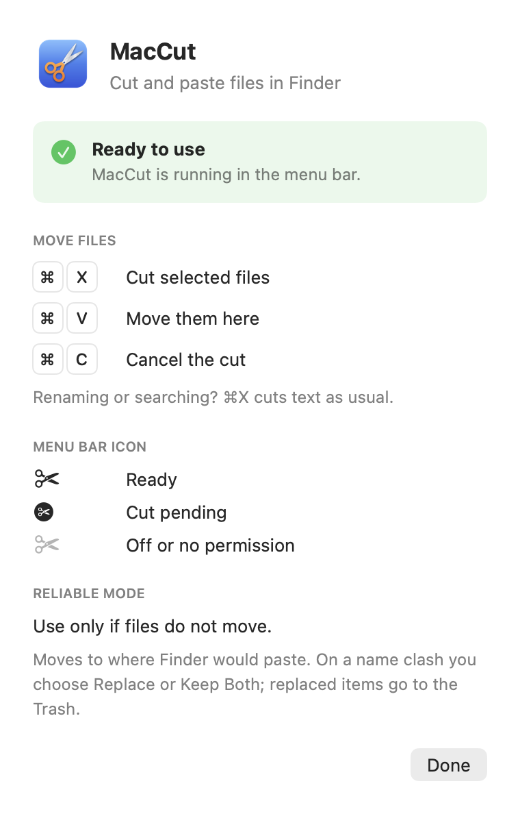

<p align="center">
  
</p>

<h1 align="center">MacCut</h1>

<p align="center">
  <b>⌘X now cuts files in Finder. ⌘V moves them.</b><br>
  The shortcut you reach for every day, finally working the way you expect.
</p>

<p align="center">
  <a href="https://github.com/njirapat/MacCut/releases/latest"></a>
  
  
  
  <a href="LICENSE"></a>
</p>

---

## Why MacCut

**🔒 Zero network access.** No telemetry, no update checks, no account. MacCut never talks to the internet, and the whole app is about 550 lines of Swift you can read in ten minutes. A tool that watches your keyboard should be this boring.

**✍️ Never gets in the way of typing.** Renaming a file or typing in Finder's search field? ⌘X cuts text exactly as it always has. MacCut only acts on files.

**🗑️ Nothing is ever lost.** If you cut and never paste, nothing moves. On a name clash you choose Replace, Keep Both or Stop, and replaced files go to the Trash so you can put them back.

**🛟 Works when other apps fight for the shortcut.** Password managers and browsers sometimes grab ⌘X or ⌘V. Flip on Reliable Mode and MacCut asks Finder to move the files directly.

**👀 You always know what is going on.** The menu bar icon shows when a cut is waiting to be pasted.

## How it works for you

1. Select files in Finder and press **⌘X**.
2. Open the destination folder and press **⌘V**.
3. That's it. Press **⌘C** any time to cancel the cut.

<p align="center">
  
</p>

## Install

1. [Download the latest release](https://github.com/njirapat/MacCut/releases/latest), unzip it and drag **MacCut.app** to Applications.
2. MacCut is not notarized by Apple (see [FAQ](#faq)), so allow it once, either way:
   - **No Terminal:** open MacCut, close the warning, then go to System Settings › Privacy & Security, scroll down and click **Open Anyway**.
   - **Terminal:**
     ```bash
     xattr -dr com.apple.quarantine /Applications/MacCut.app
     ```
3. Open MacCut and click **Grant Permission**. Turn on MacCut in System Settings › Privacy & Security › **Device Control and Data Access** (called **Accessibility** on macOS 26 and earlier).

Turn on **Open at Login** from the menu bar icon and forget about it.

## FAQ

### Why does it need permission?

- To notice ⌘X and ⌘V while Finder is in front.
- Every app that changes keyboard shortcuts needs this.
- MacCut ignores every other key and every other app, and contains no networking code at all.

### Why the extra step to open it?

- Notarizing an app requires a paid Apple Developer membership.
- MacCut is not notarized, so macOS blocks the download until you allow it once.
- Prefer not to? [Build it yourself](#build-from-source) in one command.

### Why not the Mac App Store?

- Publishing there needs a paid Apple Developer membership.
- MacCut is a free side project, so it ships here, with the source next to the download.

### What is Reliable Mode?

- **Normal mode:** ⌘X becomes Finder's copy, ⌘V becomes Finder's "Move Item Here" (⌥⌘V).
- **Reliable Mode:** skips keystrokes and tells Finder to move the selected files directly.
- Turn it on only if files do not move in normal mode.

### What does it not do?

- Edit › Paste from the menu bar copies as usual. Use the keyboard shortcut to move.
- As in Finder, open the destination folder before pasting.

## Build from source

Needs only the Xcode Command Line Tools (`xcode-select --install`), not Xcode.

```bash
git clone https://github.com/njirapat/MacCut.git && cd MacCut
bash build.sh      # -> build/MacCut.app
bash release.sh    # -> dist/MacCut-<version>.zip
```

A locally built app is signed ad hoc, so after each rebuild remove MacCut from the permission list and add it again.

## Uninstall

Turn off **Open at Login**, choose **Quit**, move MacCut.app to the Trash, and remove it from Privacy & Security.

## License

[MIT](LICENSE)
